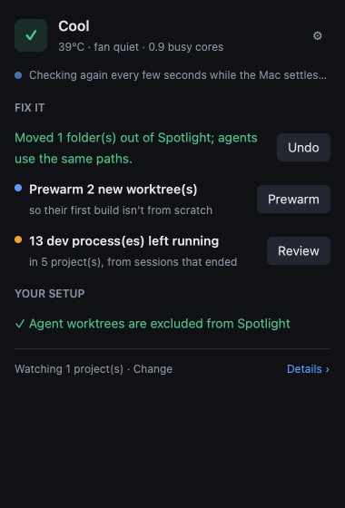
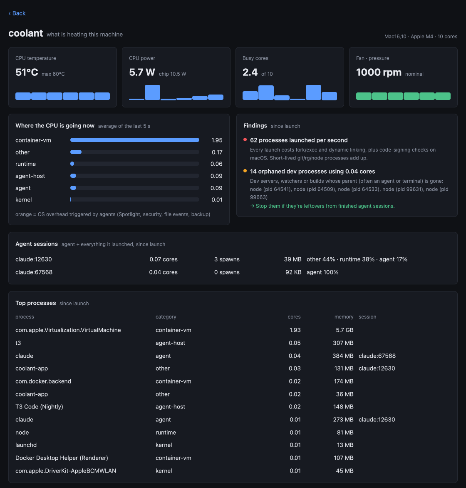

# coolant

**Why is my machine hot while AI coding agents run, and what can I do about it?**

Running several coding agents in parallel (Claude Code, Codex, Gemini CLI, …)
makes machines run hot, Macs especially. Much of that heat isn't the agents
themselves. It's work the OS and your tooling do *in reaction* to them:

- **Spotlight** re-indexing every file agents write: dependencies, build output, worktrees
- **Security checks** (`syspolicyd`, XProtect, `amfid`, EDR) on fresh binaries and thousands of short-lived processes
- **Cold builds**: every new worktree starts without `target/` or `node_modules`, so the first build redoes everything
- **Leftovers**: dev servers and watchers still running after the agent that started them finished
- **Crash loops**: a service that crashes and restarts keeps `ReportCrash` busy writing crash reports
- **Duplicates**: the same dev server or watcher started twice in one project, or two container VMs (Docker Desktop and OrbStack) running at once
- **Security software** on company Macs (CrowdStrike Falcon and similar) that checks every program start; coolant measures how much slower that makes them
- **Duplicated tooling**: one `tsserver` per worktree, file watchers on the same trees

coolant **measures** this, attributing CPU, disk I/O, process spawns,
temperature and power to categories and to agent sessions. Then it **fixes**
what can be fixed, with tools that are safe by default.

## What we measured (Mac mini M4)

From [`docs/results`](docs/results/) and [`docs/findings.md`](docs/findings.md):

| | |
|---|---|
| Copy a 3,000-file dependency tree into a Spotlight-indexed folder | **~20 CPU-s** of Spotlight work afterwards |
| Same in a `.noindex` folder | **~0.7 CPU-s** (about 30× less) |
| Copy a 20,000-file dependency tree, indexed vs `.noindex` | **50 vs 6 CPU-s** of OS overhead |
| Wall-clock difference between the two | 1–14%: the agent doesn't notice, the fan does |
| First run of a never-seen binary (every `cargo build` makes new ones) | **320–450 ms** of security checks vs 1–2 ms warm |
| APFS clonefile vs plain copy for dependencies | ~1.8× faster, but clones get indexed too, so *where* matters more than *how* |
| First `cargo build` of the GUI app in a fresh worktree | **256.7 CPU-s** cold vs **5.1 CPU-s** after `coolant prewarm` (50× less) |

## Install

**Mac app (easiest):** paste this into Terminal:

```sh
curl -fsSL https://raw.githubusercontent.com/Tarekkharsa/coolant/main/scripts/install.sh | sh
```

It downloads the newest release, checks its SHA-256, puts Coolant in
Applications, links the `coolant` command (into `/usr/local/bin` or
`~/.local/bin`) and opens the app. Coolant isn't notarized by Apple (that needs a
paid developer account). macOS only runs that check on apps a browser (or
Mail, AirDrop, …) marked as downloaded, so installing this way skips the
"Apple could not verify" warning. The
[install script](scripts/install.sh) is short; read it first if you like.

**Or download the .dmg** from the
[releases](https://github.com/Tarekkharsa/coolant/releases) and drag Coolant to
Applications. The first launch is blocked: click **Done**, then **System
Settings → Privacy & Security → Open Anyway** (once).

The app includes the `coolant` command-line tool
(`/Applications/Coolant.app/Contents/MacOS/coolant`), and the menu bar menu
has **Open at Login**.

**Command line only:**

```sh
cargo install --git https://github.com/Tarekkharsa/coolant coolant-cli
```

## Measure

```sh
coolant doctor                       # check this machine, with a fix for each problem
coolant profile -d 120 -o run.json   # record 2 minutes while your agents work
coolant report run.json              # re-render a saved run
coolant sensors                      # temperature / power / fan
coolant bench --preset quick         # reproducible agent-like workloads (~5 min)
```

## Fix

```sh
coolant tune ~/code/app/.claude/worktrees   # keep worktrees out of Spotlight and Time Machine
coolant prewarm path/to/worktree            # clone target/, node_modules … from the main checkout
coolant prewarm --install-hook ~/code/app   # …automatically for every new worktree
coolant sweep                               # list build artifacts in idle/merged worktrees
coolant sweep --yes                         # …and delete them
coolant protect ~/demo                      # never touch this path
```

- **tune** moves the folder into `~/.coolant/spaces.noindex/` and leaves a
  symlink, so agents keep using the same path while Spotlight (which skips
  `.noindex` folders and doesn't follow symlinks) leaves it alone. It also adds a
  Time Machine exclusion. `--undo` moves it back. (A `.metadata_never_index`
  marker file does not work for folders on current macOS; we tested.)
- **prewarm** uses copy-on-write (APFS clonefile, Linux reflinks): about a
  second, no extra disk until files change, and the first build becomes
  incremental.
- **sweep** only deletes artifact folders (`target/` with cargo's marker,
  `node_modules`, `.next`, `.turbo`, …) in linked worktrees that are idle or
  merged. It never touches main checkouts, and only removes whole worktrees with
  `--remove-merged` (git refuses if there are local changes).

**Safety rules everywhere:** dry runs by default where it matters; never touch
protected paths; never touch folders a running process uses; never stop
processes that serve ports exposed through Tailscale Serve/Funnel.

## The Mac app



Coolant lives in the menu bar. Click the thermometer to drop down the status
panel; right-click for Details, Launch at Login, Check for Updates and Quit.

- **Cool, warm or hot, and why.** Judged over the last half minute, with the
  main cause in plain words when it's warm ("Spotlight is re-indexing files
  your agents write, using about 2 cores"). It redraws every 10 s and a new
  status has to hold for 15 s, so nothing jumps around. After you apply a fix
  it checks every few seconds for a while, and says so.
- **Fix it, one click each,** with a confirm step that explains what will
  happen, and an Undo where one is possible.
- **Details** opens the full dashboard in its own window: temperature, power,
  busy cores and fan; where the CPU is going; agent sessions, top processes,
  and leftover dev servers grouped by project (Stop, or Keep running).
- **Settings** (the gear): the folders Coolant watches, with *Add folder…*;
  projects you keep running; Launch at login; updates.
- **Updates** are checked once a day; *Update* downloads the new version,
  checks its SHA-256, replaces the app and restarts it.

### What happens after you install it

Nothing changes on its own. Coolant looks for git projects in your usual code
folders (`~/Documents/GitHub`, `~/Developer`, `~/code`, `~/src`, `~/projects`,
`~/dev`, `~/work`, and projects directly in `~`; add others in Settings),
finds every agent worktree inside them, whichever tool made it, and watches
what's running. Problems show up under *Fix it*; nothing is moved, deleted or
stopped until you click a fix and confirm it. There's no project or working
directory to configure.

<br clear="right">



It samples every 10 s (every second only while Details is open) and idles at
about 0.2–0.3% of one core (measured on a Mac mini M4). Built with
[GPUI](https://gpui.rs), Zed's GPU UI framework.

```sh
cargo run --release -p coolant-app     # run from source
scripts/package-macos.sh               # build Coolant.app and a .dmg
```

Building needs only the Xcode command line tools; the shaders compile at
launch. `scripts/screenshot.sh` regenerates the images above
(`COOLANT_SCREENSHOT_DETAILS=1` for Details).

## How it works

- **Processes**: on macOS, `/bin/ps` (setuid, so it sees system daemons) plus
  `proc_pid_rusage` for richer counters on your own processes; on Linux, `/proc`.
- **Short-lived processes**: agents spawn huge numbers of millisecond-long
  `git`/`rg`/`node` processes that sampling never sees. coolant recovers their
  CPU from each parent's *reaped-children* counter and counts spawns from PID
  allocation.
- **Sensors without root**:
  - macOS: CPU die temperatures via IOHID; GPU and fan via SMC; power via IOReport and kernel coalition energy; thermal pressure via `notify`
  - Linux: hwmon, thermal zones and RAPL
- **Attribution**: every process is classified (agent, language server, build,
  indexer, security, …) and charged to the agent session it descends from.

See [docs/architecture.md](docs/architecture.md) for details.

## Platforms

| | profiler | sensors | workspace tools | app |
|---|---|---|---|---|
| macOS | ✅ | ✅ | ✅ | ✅ menu bar app |
| Linux | ✅ | ✅ hwmon/RAPL (when readable) | ✅ (tune is macOS-only) | planned |
| Windows | planned | planned | – | planned |

## Roadmap

1. ✅ Profiler, sensors, benchmarks
2. ✅ Workspace layer: tune, prewarm, sweep, doctor
3. ✅ Mac app: menu bar, one-click fixes with Undo (beta); next: start at
   login, notifications when the machine runs hot
4. Shared language servers and watchers across worktrees
5. Filesystem layer: copy-on-write agent workspaces (FSKit on macOS, overlayfs
   on Linux, ProjFS / Dev Drive on Windows)

## License

MIT
